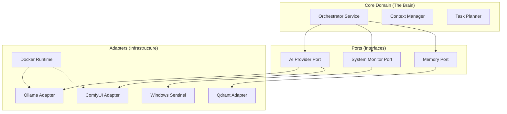

# Gilgamesh: Neural Audio Workstation

> **Status**: 🚧 Alpha (Refactoring in Progress)
> **Architecture**: Hybrid (Python/Rust/Docker)

Gilgamesh is an "Active Operating System" overlay designed to orchestrate local AI models (LLMs, Image Gen, Audio) with intelligent resource management. It aims to act as a seamless bridge between raw hardware performance and high-level AI orchestration.

## 🏗 Architecture Overview (Target: Hexagonal)

The system is transitioning to a Hexagonal Architecture (Ports & Adapters) to decouple the "Brain" (Orchestrator) from the "Body" (Docker/Hardware).



### Components

| Service | Technology | Role |
| :--- | :--- | :--- |
| **Orchestrator** | Python (FastAPI) | Resource manager, task router, context switcher. |
| **Sentinel** | Python (Windows Native) | Security agent, hardware monitor, "Bodyguard". |
| **Memory** | Qdrant | Vector database for RAG and long-term memory. |
| **ComfyUI** | Python/PyTorch | Image/Video generation engine. |
| **Ollama** | Go/GGML | Local LLM inference. |
| **Whisper** | Python/PyTorch | Audio transcription. |

## 🚀 Getting Started

### Prerequisites
*   Windows 10/11
*   NVIDIA GPU (8GB+ VRAM recommended)
*   Docker Desktop (with WSL2 backend)
*   Python 3.10+

### Installation

1.  **Clone the repository:**
    ```bash
    git clone https://github.com/W3SS/GilgaMesh.git
    cd GilgaMesh
    ```

2.  **Environment Setup:**
    ```bash
    cp .env.example .env
    # Edit .env with your API keys (Discord/Telegram) and paths
    ```

3.  **Start the Mesh:**
    ```bash
    docker-compose up -d
    ```

4.  **Start Sentinel (Native):**
    ```bash
    cd sentinel
    pip install -r requirements.txt
    python sentinel_service.py
    ```

## ⚠️ Critical Analysis & Roadmap (v2.0 Refactor)

The architecture is currently migrating from a "Monolithic Script" to a modular design. We are adopting an **iterative selection strategy** to avoid stalling development.

### Lessons Learned
1.  **God Classes are fragile**: The original `PrometheusOrchestrator` held too much state, making concurrent context switching buggy.
2.  **Hardcoding is rigid**: Embedding VRAM limits prevented dynamic tuning for different GPU tiers.

### Active Migration Roadmap

#### Phase 1: Configuration & Stability (Current Priority)
- [ ] **Config Extraction**: Move `VRAM_LIMITS` and URLs to `pydantic-settings` (env var driven).
- [ ] **Logging Standardization**: Replace print/logging mixed calls with structured JSON logging.

#### Phase 2: Infrastructure Decoupling
- [ ] **Docker Adapter**: Extract all `docker-py` calls into a `ContainerRuntime` adapter.
- [ ] **AI Interfaces**: Define `TextGeneration` and `ImageGeneration` protocols.

#### Phase 3: Domain Purification
- [ ] **Context Logic**: Isolate the "Predictive Swap" math into a pure Python module (no I/O).
- [ ] **Task Planner**: Create a dedicated planner for complex multi-stage requests.

### Final Acceptance Criteria (v2.0)
1.  **Zero Hardcoding**: All thresholds/models configurable via `.env`.
2.  **Testability**: Core logic (Context Switching) has 90%+ unit test coverage (mock-free).
3.  **Pluggability**: Can swap Ollama for another LLM provider by changing 1 config line, not code.

## 🤝 Contributing

We welcome contributions! Please check the `implementation_plan.md` (if available in artifacts) or the Roadmap above before starting major refactors.

---
*Powered by the Antigravity Kit*